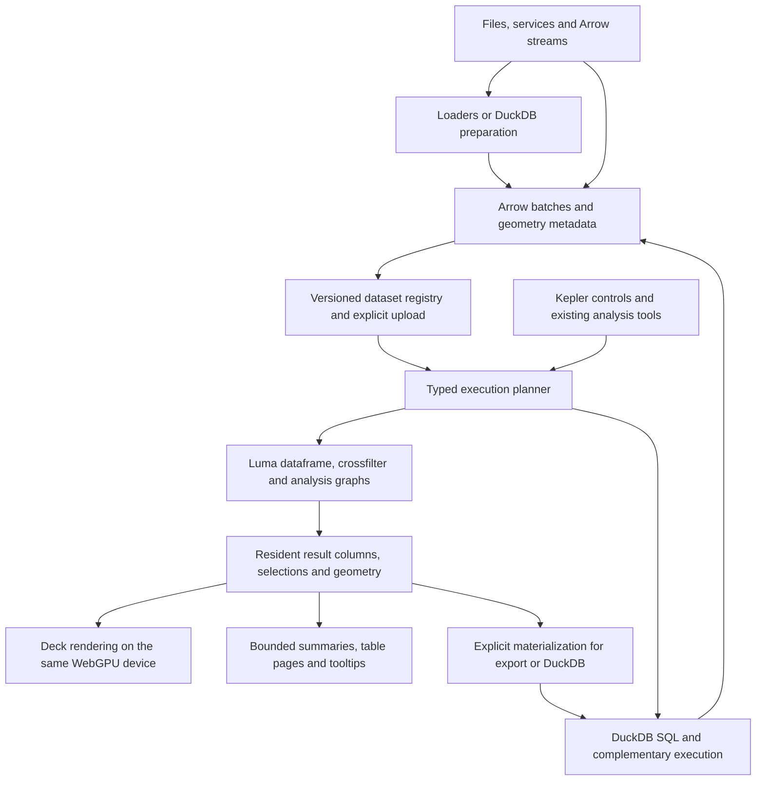

> **Archived 2026-11-07.** Copied from the luma.gl `map-contributors` branch (`dev-docs/roadmaps/kepler-compute-integration-plan.md`). Paths such as `modules/graph/src/...` and `@luma.gl/graph/...` refer to that branch, not this repository. Current plans: [roadmap](../roadmap.md). Superseded by the roadmap; the live status is in research/kepler-sandbox-2026-10-28.

# kepler.gl integration with luma compute

Date: October 28, 2026. Status: implementation target. Delivered contracts and remaining boundaries
are tracked in the [implementation record](./kepler-compute-integration-implementation.md).

Make luma the execution backend for Kepler's interactive visualization and supported analysis:
upload a working dataset once, filter it, compute statistics and derived results, and render those
results from GPU resources. Keep DuckDB as a complementary source and execution engine for ingestion,
general SQL, exact wide-number operations, text processing and workloads that do not fit GPU memory.

The next priority is an integrated execution path. The existing contributor catalog covers much of
the numerical work, but Kepler's row-oriented consumers, rendering dependencies and result lifecycle
still need an adapter and targeted changes in Kepler. Broadening the SQL parser alone will not achieve
this goal.

## Scope and completion criteria

“Completely backed by luma compute” means every workflow in an agreed Kepler feature matrix has an
explicit execution path, and the supported interactive path remains on the GPU from selection through
rendering. It does not mean uploading the entire database, running the UI on the GPU, or implementing
DuckDB's SQL language and storage engine.

The target has three independently measurable levels:

1. **Analysis integration:** existing Kepler tools can invoke luma contributors, publish typed results,
   show diagnostics and save reproducible recipes. Explicit result materialization is acceptable.
2. **Resident interactive integration:** filtering, linked summaries, styling, supported aggregation,
   analysis and map rendering share GPU data. Normal interactions do not materialize all selected
   rows, rebuild JavaScript feature objects or upload the source dataset again.
3. **Complete agreed workflow coverage:** every supported layer, filter, analysis tool, table view,
   export and saved-session path passes integration tests. Complementary execution is explicit;
   unsupported cases are never described as GPU accelerated.

Level 2 is the first product target. Level 3 requires a feature ledger, not a claim that the presence
of a numerical kernel establishes frontend compatibility. GPU support must remain useful with an
Arrow source and no DuckDB connection; DuckDB should be optional for that path.

## Current implementation sequence

The latest broad October 30 checkpoint compiles every module and passes 554 Kepler Node tests.
Focused acceptance covers separate-series charts, second/millisecond UTC hour/day/week/month/year
charts, native time histograms, bounded Dorling cartograms and ordinary kriging. Streaming publication,
projected analysis, heatmap, GeoJSON vertical controls, scalar point labels and tabular point altitude
also have native acceptance evidence.
The implementation record distinguishes these focused results from the older full-suite baseline.
Work continues in parallel:

| Lane | Next implementation | Acceptance boundary |
| --- | --- | --- |
| Linked charts | Extend bounded calendar/series contracts beyond accepted hour/day/week/month/year and native time histograms | Preserve exact grouping/click semantics, self-filter exclusion and source buffers; micro/nanosecond admission remains explicit |
| Rendering | Extend remaining layer families, non-point altitude roles and richer labels | Match native pixels/controls, preserve source rows and chunks, and retire per-layer resources behind fences |
| Spatial analysis | Extend remaining tool/weight variants beyond the accepted bounded ordinary kriging workflow | Reuse source-wide topology and existing summaries; distinguish source-wide geometry eligibility from selected statistical populations |
| Lifecycle and scale | Expand the one-million-row smoke comparisons to target-level samples, hardware tiers and combined consumers | Keep original benchmarks immutable; report cumulative encodes, CPU latency, transfers and accounted memory separately |
| Native data operations | Bind the native Group By panel to bounded GPU grouping and typed result publication | Preserve key/measure semantics, source lineage, selection revisions and replay; unsupported operations use an explicit complementary route |
| Streaming and persistence | Remote streams and explicitly persisted partial populations | Retain completed-source semantics and bounded admission; do not infer completeness from a visible prefix |

Focused CPU and GPU checks accompany each lane. GPU/browser runs share one execution slot; source
implementation proceeds independently. Root compilation is a periodic integration checkpoint.
The full root test and website gates remain required before merge preparation, without making them
a prerequisite for every bounded implementation step.

## Evidence and existing goals

The earlier “Connect contributors to kepler.gl” discussion identified dataset adapters, live analysis,
result publication, filter semantics, saved recipes and a shared rendering device. The
[Kepler backlog](./geospatial-coverage-backlog.md#kepler-analysis-coverage-2026-10-25) then scoped
six analysis gaps. The [implementation record](./kepler-analysis-implementation.md) delivers bounded
KG01–KG05 operations and partial KG06 SQL support; it explicitly leaves frontend integration open.

This plan assesses the working tree based at `cc97a1c148a737d620d903c3f4424d8d23bca74b`, including
existing uncommitted work. Implementation presence is separate from release availability and current
full-suite validation. The SQL ledger (local research log, not checked in) preserves
the October 26 incomplete full-suite result; this planning work does not turn it into a passing gate.

The consumer baseline is Kepler `4b5d4b4d9d4f73fbacaf973c292a871ddf657302`, version
`3.3.0-alpha.18`, matching the earlier ledger. It is a pinned integration target, not a claim about
the latest release. Source review establishes these constraints:

- [KeplerTable](https://github.com/keplergl/kepler.gl/blob/4b5d4b4d9d4f73fbacaf973c292a871ddf657302/src/table/src/kepler-table.ts)
  keeps `filteredIndex`, `filteredIndexForDomain` and per-layer indices as JavaScript arrays. Its
  filter and domain paths still consume CPU rows. Display, domain and polygon selections differ.
- [DataContainerInterface](https://github.com/keplergl/kepler.gl/blob/4b5d4b4d9d4f73fbacaf973c292a871ddf657302/src/utils/src/data-container-interface.ts)
  requires synchronous cell and row access, iteration, mapping and flattening. A resident table
  cannot implement those operations transparently without CPU copies or API changes.
- [Kepler's dependency pins](https://github.com/keplergl/kepler.gl/blob/4b5d4b4d9d4f73fbacaf973c292a871ddf657302/package.json)
  use deck 9.3.1 and luma 9.3.2. This checkout's
  [GPU layers](../../modules/deck-gpu-layers/package.json) use patched deck core 9.4.0 and luma
  10.0.0-alpha.4. Shared-device compatibility must be demonstrated first.
- [Kepler's DuckDB table](https://github.com/keplergl/kepler.gl/blob/4b5d4b4d9d4f73fbacaf973c292a871ddf657302/src/duckdb/src/table/duckdb-table.ts)
  materializes Arrow columns and restores geometry metadata during import. Its output is a useful
  bridge boundary, but its compaction and materialization policies cannot simply become implicit
  GPU streaming behavior.

## Proposed architecture

Keep serializable dataset identifiers, field definitions, recipes and control state in Kepler's state.
Keep devices, buffers, compiled graphs and in-flight work in an application-owned runtime registry.
Map a dataset revision to its CPU source, optional DuckDB relation, GPU columns, validity, dictionaries,
geometry, coordinate metadata and source-row identities. Each representation records the revision it
represents; a GPU-derived column need not have a CPU array until an explicit consumer requests one.

Use typed operation requests for known UI actions and analysis tools. Reuse `GPUDataFrame`, contributor
contracts and existing graph metadata rather than inventing another numerical expression language.
Retain `LuSQLContext` for its supported SQL surface. Arbitrary SQL entered by a person or generated by
an assistant goes to DuckDB by default.

Unsupported statistical variants retain the pinned host's existing analysis backend, such as GeoDa,
until an audited luma equivalent is ready. DuckDB is not a substitute for every statistical tool.
Record those exceptions in the feature ledger and require their migration before claiming complete
GPU coverage of that analysis family.

Start routing at operation or materialized-stage boundaries. Splitting arbitrary SQL between two
optimizers is unnecessary for the first integration and risks expensive repeated transfers.

Keep the Kepler/DuckDB adapter in the integration application initially, then extract it only when
its contracts stabilize. `@luma.gl/gpgpu/gpu-data` retains primitive storage;
`@luma.gl/graph/gpu-tables` retains tables and generic planning; graph subpaths retain algorithms;
`@luma.gl/arrow` owns Arrow conversion. GPU layer packages own render bindings. Add no Kepler,
DuckDB or Arrow dependency to the compute primitives. Preserve source batches during streaming;
packing, dictionary reconciliation and residency copies must be explicit operations with owners.

## Capability and gap matrix

This matrix records the foundation and gaps at the initial planning audit. Several adapter gaps have
since been implemented; use the [implementation record](./kepler-compute-integration-implementation.md)
for current delivery status. The
[feature review](../research/kepler-sandbox-2026-10-28/capability-matrix.md) inventories the full target
surface; its individual status rows need reconciliation as implementation lands.
“Exists” means a local implementation was available to reuse, not that Kepler integration was
validated. “Integration gap” requires host or adapter changes. “Extension” means an existing
owner needs additional contracts or behavior.

| Workflow | Existing foundation | Remaining work | Priority |
| --- | --- | --- | --- |
| Dataset registration and upload | `GPUData`, `GPUVector`, `GPURecordBatch`, `GPUTable`, Arrow analytics upload/readback | Integration gap: versioned Kepler dataset registry, selective upload, ownership and source identity across derived results | P0 |
| Common input types | Analytics adapter accepts Float32, Int32, Uint32 and UTF-8 dictionaries with 32-bit indices | Extension: explicit Boolean and narrow-integer normalization, date/time upload paths, category encoding and evolving dictionaries; route Float64/decimal/general Int64 arithmetic deliberately | P0 |
| Numeric filtering and linked charts | `GPUDataFrame`, `GPUCrossfilter`, masks, self-excluding histograms, stable compaction | Integration gap: reproduce Kepler's display/domain/per-layer semantics; remove CPU filtered-index dependency from active consumers | P0 |
| Categories and text filters | Dictionary labels plus GPU integer codes; dataframe predicates and external crossfilter masks | Extension/integration: multiselect and null policy, cross-batch dictionary reconciliation, category sorting and high-cardinality summaries. Free-text search can remain in DuckDB | P1 |
| Time sliders and playback | `GPUTimeWindowFilter` supports signed Int64 word comparisons and intervals; `GPUCalendarBuckets` supports time-zone transitions | Integration gap: units, Arrow upload, time-zone metadata, trips and crossfilter external masks; calendar contributor needs explicit chunk orchestration | P1 |
| Polygon, rectangle and brush selection | Bounds dimensions, point-in-polygon/spatial predicates, buffer selection, external masks | Integration gap: per-layer geometry semantics, holes/boundaries, multi-dataset filters, screen-space brushing and geographic distance contracts | P1 |
| Domains, legends and classification | Column profiles, quantiles, class breaks, group statistics and color-scale helpers | Integration gap: filtered versus fixed domains, nulls, tie rules and Kepler scale parity. Exact natural breaks has a 1024-row/64-class bound | P1 |
| Grid, hexbin and heatmap | Grid aggregation, point/kernel density, cell aggregation and hierarchies | Integration gap: Kepler/deck cell origin, projection, zoom, weight, percentile and normalization semantics; outputs need layer and picking adapters | P1 |
| H3 and S2 layers | Cell identities, hierarchy/geometry operations and Arrow DGGS helpers | Integration gap: lossless cell IDs, resolution changes, aggregation and polygon publication; audit each requested operation instead of assuming whole-library parity | P2 |
| GPU map rendering | GPU point, line, arc, path, polygon, icon, text and other layer implementations; Arrow trips layer | Extension/integration: shared-device compatibility, selection/indirection/count contract, style parity, source-ID picking, geometry changes and layer-specific support | P0/P1 |
| Table inspection and tooltips | Source metadata, picking provenance, explicit Arrow readback and sort primitives | Integration gap: asynchronous page/gather requests and revision-aware cache; remove synchronous access to GPU-only computed columns | P1 |
| Statistical and spatial analysis | Weights, Moran/Geary/Getis–Ord, regressions, joins, geometry, density; KG01–KG05 additions | Integration gap: executable tool bindings, parameter/default parity, typed results, diagnostics, inference policy and weights lifecycle | P1 |
| Relational data wrangling | Numeric expressions, CASE/COALESCE, nullable counts, bounded grouping/order/joins | Extension only when justified: joined right-column projection, sparse/multiple group keys, broader composition. Keep full SQL, general text and many-to-many joins in DuckDB initially | P2 |
| Streaming and memory | Chunk-preserving tables and vectors; fixed-capacity residency arena and live masks | Integration gap: upload scheduling, backpressure, residency policy, revisions, graph topology changes and complete-population analysis restrictions | P1 |
| Application lifecycle | Graph compilation/replay and showcase compute-before-render effect | Integration gap: cancellation, latest-result publication, device loss, cleanup, errors, diagnostics and saved-session restoration | P0/P1 |
| External data services and basemap tiles | Host/loaders/DuckDB responsibilities | Keep outside the compute migration; adapt query results when they become analysis inputs | Complementary |

The general analytics upload helper is narrower than the complete GPU storage and geometry APIs.
In particular, Int64 time contributors already exist even though the general dataframe analytics
adapter does not accept Arrow Timestamp directly. Fix that adapter seam before proposing a new
time-comparison kernel.

## Required contracts

### Dataset types, precision and identity

Give every logical dataset a stable identifier and revision. Preserve `(dataset, revision, batch,
source row)` identity through filtering and sorting; retain explicit left/right lineage through
joins and group membership or lookup metadata through aggregation. Physical buffer positions and
residency slots are not persistent row identities.

Keep source numeric types and units in metadata. Classify each operation as exact, bounded error,
explicit approximation or unsupported. Permit a Float64-to-Float32 conversion only through an
explicit policy with a documented error budget. Preserve opaque identifiers, H3/S2 values and absolute
timestamps as integers/word pairs or source metadata; never cast them to Float32 for convenience.
General Float64 SQL arithmetic remains a DuckDB responsibility unless a specific audited implementation
is added. Geographic rendering and projection require their own origin/precision strategy; do not
equate drawing a Float32 coordinate with accurate spatial analysis.

Normalize missing values once at the adapter boundary while preserving the distinction between null,
NaN and infinity. Dictionary encoding must specify equality, order, collation and unknown categories.
The original analytics adapter rejects dictionary changes between batches. The integration's explicit
normalization now reconciles source dictionaries. The stream publisher now supplies immutable prefix
revisions and stable append-only dictionary codes, with explicit complete-population guards and
completed-stream recovery and native IPC ingestion. Incomplete prefixes remain explicitly marked
previews and are not portable finite datasets; remote streaming and persisted partial populations
remain separate integration work.

### Selection and analysis semantics

Represent display selection, domain selection, analysis population and per-layer spatial selection
separately. Crossfilter's self-excluding histogram policy is a building block, not automatically the
same as Kepler's dynamic-domain rules. Compose category, time and spatial masks through the existing
external-mask mechanism where practical.

“Hide unselected results” and “recompute on selected observations” must be distinct controls. A filter
can change a regression sample, an expected rate or a neighborhood graph. Cache spatial weights by
dataset revision, geometry/CRS, neighbor parameters, normalization and population policy. Specify whether
subsetting induces a subgraph and renormalizes it or preserves the original weights.

### Rendering without bulk readback

Define a reusable resident layer input containing columns/geometry, selection mask or row indirection,
live count, source identity and revision. Support either GPU mask consumption or explicit GPU gather
plus GPU draw counts. For paths and polygons, selection is at feature level while storage may be at
vertex/ring level; preserve feature-to-vertex mapping and picking through tessellation.

Do not assume this contract exists uniformly across the GPU layer family. The implementation now adds
selection-mask consumption to
[`GPUScatterplotLayer`](../../modules/deck-gpu-layers/src/layers/gpu-scatterplot-layer.ts)
and the initial line/arc/geometry adapters. Its picking shader still encodes row indices in 24 bits;
large datasets require batch/layer disambiguation or another picking strategy, with tests at the
boundary. Scatterplot primitives now accept XYZ positions, and prepared GeoJSON points use them;
tabular altitude roles and full Kepler precision behavior still need a layer-specific adapter audit.

Reuse the showcase's
[`SpatialAnalysisDeckEffect`](../../examples/deck/spatial-analysis-showcase/src/engine/analysis-effect.ts)
to encode compute before rendering. Deck owns submission on the shared WebGPU device. Do not re-run
analysis during picking or accidentally submit the same work twice. A WebGPU-to-WebGL readback bridge
can provide Level 1 compatibility, but cannot satisfy Level 2. A basemap may use its own renderer;
the critical shared device is between luma compute and the Deck layers consuming its buffers.

### Result publication and execution lifecycle

An operation declares input schemas, required formats/coordinate model, parameters, output schema,
capacity, estimated memory, numerical policy and diagnostics. Its result records source revisions,
parameters, backend, algorithm version and completion status. Only completed results matching the
current request revision can replace displayed data.

Keep a bounded queue, coalesce slider changes and stop scheduling superseded work. Submitted GPU
commands are not generally preemptible; cancellation means discard stale completion and avoid future
dispatches, with long algorithms divided into bounded submissions where necessary. Track resource
lifetimes until dependent rendering/readback finishes. Treat failed encodings and submissions as
invalidation events so crossfilter caches cannot advertise stale results as current.

Expose meaningful capacity, overflow, invalid-input and convergence status. In particular, consume
join contract violations before publishing a result, and show cartogram nonconvergence. Device loss
rebuilds resources from retained source/recipes or switches the host to a declared complementary path.

### Native Group By publication

The next implementation binds the pinned native Group By action to a bounded asynchronous GPU
executor. This is a planned contract, not accepted workflow coverage. `RUN_GROUP_BY` identifies
the operation by ID; capture its parameters from the matching native `groupBys` record together with
the source/request revision. The native operation uses all source rows regardless of active map filters. Preserve one null/undefined key group, first-source-
occurrence group order, count including null measures, null outputs for all-null non-count groups,
aggregation insertion order, collision-safe native output names and `metadata.derivedDataset` lineage.

The initial scope caps source rows at one million, uses one prepared string-dictionary key with
at most 4,096 domain values including null, at most 16 aggregations and at most 1 MiB of key text. Count may reference any declared field; sum, average, minimum and
maximum require finite Float32 measures. No measures means distinct observed keys. Unsupported keys,
methods and types remain editable native operation errors with explicit SQL guidance. No implicit
DuckDB or retained-row CPU fallback runs. Float32 sum/average precision and accumulation order must
be documented and tested; refusing nonfinite inputs/outputs does not imply exact JavaScript-number
parity.

Use existing grouping/reduction primitives and explicit first-row indices to reorder observed groups
on the GPU. The derived dataset has its own explicit output batching and immutable generation;
original source batches and buffers do not change. Publish through the existing result registry with
source/request revisions, cancellation, fenced retirement and rollback before native visibility.

Bounded result-only readback constructs honest retained Arrow values for inspection, recovery and
export. Adopt the dedicated computed GPU columns and validity without a result reupload, source
readback or source reupload. Validate schema, formats, lengths and ownership at this boundary; do not
fabricate Arrow rows or borrow mutable analysis scratch as a persisted result. Retained Arrow
dictionary metadata and adopted GPU key codes must share exactly the same mapping after group
reordering, including unobserved labels and null keys. Admit output, scratch,
readback, Arrow and key-string bytes before allocation, with explicit text-byte limits as well as group
and aggregation caps. The operation's all-population lineage and native parameters persist in portable
state. Completed results are independent snapshots: source removal cancels pending operations but
does not remove completed derived datasets. Their historical lineage survives standalone recovery;
rerunning the operation requires a current input. Acceptance must cover nulls, first-occurrence order,
filtered-map independence, native output
names/types, stale/cancelled jobs, resource rollback, result inspection/export/recovery and unchanged
source uploads.

### DuckDB cooperation

| Direction or workload | Contract |
| --- | --- |
| DuckDB to luma | Query/project the needed working set, preserve Arrow schemas and geometry metadata, then explicitly upload selected columns in source batches |
| Repeated interaction | Reuse resident columns, compiled plans and prepared spatial structures while only parameters/masks change |
| GPU result to DuckDB | Explicitly materialize selected result columns and stable IDs as Arrow, register a versioned relation, and account for synchronization/readback cost |
| General SQL, text, exact wide arithmetic and complex joins | Route to DuckDB before GPU execution; return a declared new dataset revision for GPU use |
| Capacity or diagnostic failure | Publish a failure/status; optionally execute an application-approved complementary route with the same inputs and semantics, never trust partial GPU output |

Do not call these boundaries zero-copy: CPU/WASM Arrow data normally requires a GPU upload, and GPU
results require readback before DuckDB consumes them. Cache by revisions and requested columns to avoid
repeated crossings. Large datasets need source pushdown and bounded working sets; DuckDB-WASM memory
limits must also be measured, with remote execution available when neither browser backend can fit.

## Implementation backlog and acceptance

The IDs below are integration work and do not reopen the delivered KG01–KG05 algorithms. P0 blocks
the resident path; P1 supplies the main workflows; P2 follows measured consumer demand.

| ID | Priority and owner | Deliverable | Acceptance |
| --- | --- | --- | --- |
| KI01 | P0, integration app and Kepler | Pin Kepler, deck, luma, loaders and Arrow; capture actual layer/tool/filter inventory and required local patches | One compatible WebGPU device renders a computed point and polygon, picks them and cleans up correctly in an embedded Kepler shell |
| KI02 | P0, application adapter | Versioned dataset/resource registry with CPU, DuckDB and GPU representations | Upload once; two consumers borrow the same resources; replace/delete cannot publish stale values or destroy borrowed buffers |
| KI03 | P0/P1, `@luma.gl/arrow` and adapter | Schema/validity/identity bridge; explicit numeric conversion, time words and category policy | Sliced nullable batches, mismatched chunks, timestamps, Boolean/narrow integers and dictionary changes either map correctly or route with a precise reason |
| KI04 | P0, Kepler table/layer consumers | Asynchronous compute-backed dataset access alongside existing CPU containers | Supported layer/domain paths do not call `flattenData`, iterate all CPU rows or require full JavaScript filtered indices after upload |
| KI05 | P0, GPU layers and integration effect | Shared selection, identity and count contract; compute/render scheduling | Slider changes update the map from GPU selections; picking resolves original rows after filtering/sorting; no full-selection readback |
| KI06 | P1, crossfilter/dataframe adapter | Numeric/category/time/spatial filter translation and separate mask policies | Kepler reference fixtures agree on endpoints, nulls, own-filter exclusion, dynamic domains and per-layer polygon selection |
| KI07 | P1, dataframe and UI adapter | Domains, quantiles, classification, histograms, category summaries and legends | Charts and map share a revision; only bounded summaries are read; exact versus approximate classification is visible and limits are enforced |
| KI08 | P1, geometry/aggregation and layers | Grid/hex/density and geometry/trips adapters | Each approved layer passes aggregation, coordinate, feature identity, style, time and picking parity tests at recorded scales |
| KI09 | P1, analysis adapter and existing tool hooks | Bind supported tools to typed contributor recipes, weights cache and diagnostic presentation | Existing analysis workflow runs, publishes computed fields/new geometry and restores from saved configuration without an unnecessary GPU-to-CPU-to-GPU round trip |
| KI10 | P1, Kepler table and tooltip UI | Asynchronous table paging, sorting, gathering and computed-field inspection | Table pages and hover values match the displayed revision; row IDs need not all be downloaded; page size and readback budget are bounded |
| KI11 | P1, application execution planner | Capability/precision/capacity routing and DuckDB exchange | Identical requests select a documented route; explicit conversions and transfers are measurable; arbitrary SQL still works through DuckDB |
| KI12 | P1, runtime and gpu-tables | Memory accounting, residency, backpressure, chunk scheduling and device recovery | Memory includes source, GPU, scratch and readback copies; over-budget work is rejected/routed; eviction preserves identity and cannot corrupt complete-population analysis |
| KI13 | P1, Kepler schema/export adapter | Save/replay recipes, publish results and filtered exports | Save/reload reconstructs inputs, parameters, population policy, backend policy and layers; export obeys the same selection semantics as the map |
| KI14 | P1, integration tests and performance harness | Differential correctness and interaction benchmarks | Replayable end-to-end cases pass with measured transfer volume, memory, latency and diagnostics on named device/browser combinations |
| KI15 | P2, dataframe/SQL owners | Consumer-driven relational extensions | Add only measured blockers: likely right-column projection, grouping capabilities or explicit composition; preserve documented join and precision contracts |
| KI16 | P2, existing algorithm owners | Expand bounded analysis modes and capacities | Benchmarks justify larger exact breaks/cartograms, multivariate quantile LISA or missing geometry modes; each has independent numerical evidence and capacity contracts |

For KI08, maintain separate rows for point, arc, line, polygon/GeoJSON, grid, hexbin, heatmap, cluster,
icon, H3, S2, trips and vector tiles, plus any layer in the pinned host's actual registry. Track text
and raster/bitmap outputs when analysis emits them. A wrapper's name is insufficient: verify style
properties, altitude, projection, selection, picking and export. Viewport clustering needs its own
semantic audit; a spatial clustering contributor is not automatically Kepler's cluster layer.
Vector-tile fetching/decoding can remain a host concern while selected decoded features enter compute.

For KI09, begin with weights → local Moran/hot spots → classification, rate mapping and standardization.
Then audit quantile LISA, regression, spatial joins, geometry tools and cartograms against the pinned
frontend/tool packages. Existing operator metadata can seed discovery; it is not a complete executable
UI form or tool adapter. Preserve documented differences: quantile LISA's legacy directed tail is
anti-conservative for all ties, exact breaks optimize a bounded Float32 objective, and Dorling's
1024-row/256-pass relaxation is a heuristic with no convergence guarantee. Do not expose these as
unqualified equivalents to upstream analysis.

## Delivery sequence

| Milestone | Dependencies and work | Exit gate |
| --- | --- | --- |
| M0 Compatibility and inventory | KI01; list every real consumer of rows, indices, domains and results | Working shared-device spike and an agreed capability ledger; otherwise ship only an explicitly materialized Level 1 prototype |
| M1 Resident vertical slice | KI02–KI05, narrow KI06/KI07/KI10 and basic cleanup | Arrow or DuckDB numeric point dataset → time/range/category filters → linked histogram → GPU point layer → source tooltip; repeated interaction has no full-table readback/upload |
| M2 Daily exploration | Complete KI06/KI07/KI10; first grid/hex/density and polygon/trips work in KI08 | Correct linked filters, domains, summaries, table inspection and principal map layers using shared selections |
| M3 Existing analysis workflows | KI09 plus KI11/KI13; build on M1 data contracts | Weights/hot spots, rates, standardization and selected geometry workflows produce reusable GPU results and saved recipes; unsupported work still works via declared complementary execution |
| M4 Broad layer and lifecycle coverage | Complete KI08/KI12/KI13 | Agreed layer matrix, append/replace/delete, large-data routing, memory pressure and device-loss cases pass |
| M5 Release readiness and selective expansion | KI14 throughout; KI15/KI16 only for proven blockers | Full required gates pass; supported hardware, capacities, precision modes and fallback behavior are documented with reproducible measurements |

The first implementation should be M0 and M1. That exposes the architectural risks before expanding
the SQL frontend or adding more contributors. M2 and M3 can be developed independently after their
shared data and execution contracts stabilize. Calendar estimates should follow the compatibility
spike and actual host inventory; a point-layer prototype is not an estimate for the entire Kepler UI.

## Verification and performance gates

Build a consumer fixture corpus, not just standalone kernel tests. Compare with the pinned Kepler
behavior for filters, domains, layers and saved state; use pinned DuckDB for supported relational
semantics and GeoDa/reference oracles for statistical modes. Separate exact integer/mask comparisons,
floating-point tolerances, approximate algorithms and intentional upstream differences.

Required cases include empty/all-null data, NaN/infinity, boundary ties, large identifiers,
pre-1970 and microsecond timestamps, daylight-saving transitions, changing dictionaries, sliced Arrow
arrays, unequal chunk boundaries, holes/multipolygons, antimeridian geometry, duplicate join keys,
selected-versus-global weights, concurrent control changes, append/delete, device loss and overflow.
Test original source identity through joins, sorting, tessellation, aggregation and residency eviction.

Use three initial benchmark families: 100,000/1 million/10 million point rows where memory permits;
10,000/100,000 polygons with recorded vertex counts; and a long trips dataset with vertex timestamps.
Keep bounded exact-break and cartogram cases within their published limits. Record source bytes,
geometry vertices, category cardinality, neighbor edges and scratch size, because row count alone does
not predict cost. Include cold preparation/upload, warm interactions, result inspection and export.

Proposed targets to validate on named reference hardware:

- Warm simple filter-to-map updates at p95 below 50 ms for the 1-million-point case, with linked compact
  summaries below 100 ms. These are acceptance targets, not measured claims.
- Playback aims for a 16.7 ms frame budget on the reference desktop; qualify lower hardware tiers
  separately. Heavy inference runs asynchronously and must not block control feedback.
- Zero full-dataset upload or readback on supported warm filter/style interactions. Count all transfers,
  including filtered index arrays, geometry regeneration and hidden worker copies. Permit declared
  bounded summary/table/tooltip transfers and explicit export/materialization.
- Measure end-to-end latency against existing Kepler and the DuckDB route using identical inputs and
  semantics. Report CPU encode, GPU execution, synchronization, transfer bytes, peak memory and p50/p95.
  Prefer DuckDB/CPU for a small or cold workload when the measured end-to-end cost is lower.

For implementation and merge preparation, run `nvm use`, `yarn install`, `yarn lint fix`, final
`yarn build`, `yarn test`, `yarn website:build` and `(cd website && yarn build)`. Run targeted
`yarn test-node` as well when shared table APIs change. Add the pinned Kepler adapter's build and browser
integration suite. A focused GPU pass does not replace the full build/test gates.

## Source map

- [GPU dataframe overview](../../docs/api-reference/experimental/gpu-dataframe.md) and
  [operations](../../docs/api-reference/experimental/gpu-dataframe-operations.md).
- [GPU crossfilter](../../docs/api-reference/experimental/gpu-crossfilter.md), including external masks,
  invalidation and the explicit approximation of bin-snapped histogram cubes.
- [Arrow analytics upload](../../modules/arrow/src/arrow/gpu/arrow-gpu-analytics-adapters.ts) and
  [readback](../../modules/arrow/src/arrow/gpu/arrow-gpu-analytics-readback.ts).
- [Time-window filtering](../../modules/graph/src/gpu-dataframe/time-window-filter/gpu-time-window-filter.ts),
  [calendar buckets](../../modules/graph/src/gpu-dataframe/calendar-buckets/gpu-calendar-buckets.ts) and
  [residency arena contracts](../../modules/graph/src/gpu-tables/residency-arena/residency-arena-types.ts).
- [GPU layer exports](../../modules/deck-gpu-layers/src/index.ts),
  [Arrow layer exports](../../modules/deck-arrow-layers/src/index.ts) and
  [projection contracts](../../modules/graph/src/gpu-project/README.md).
- [SQL supported grammar and execution boundary](../../docs/api-reference/experimental/gpu-sql.md),
  Kepler SQL query ledger (local research log, not checked in) and
  [analysis implementation limits](./kepler-analysis-implementation.md).
